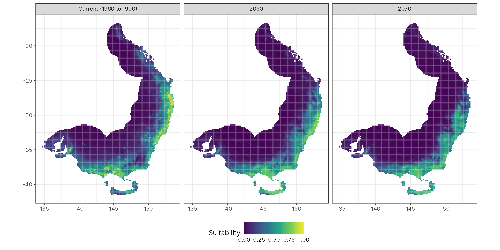
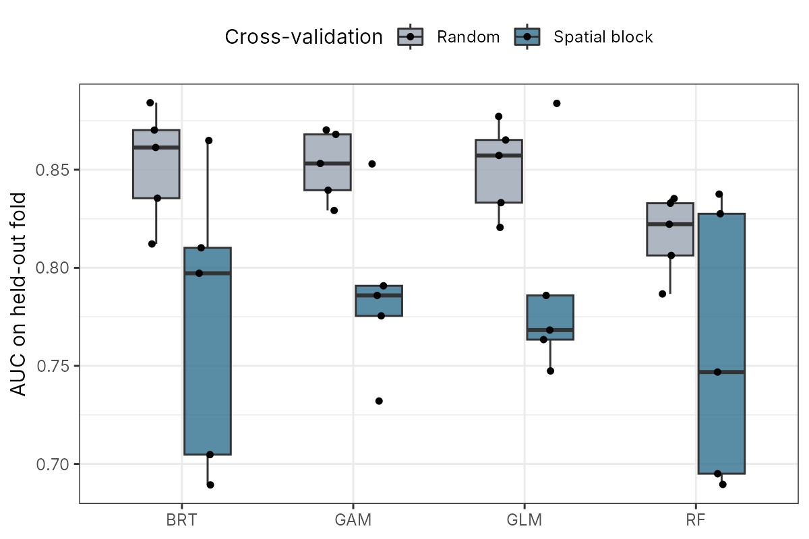
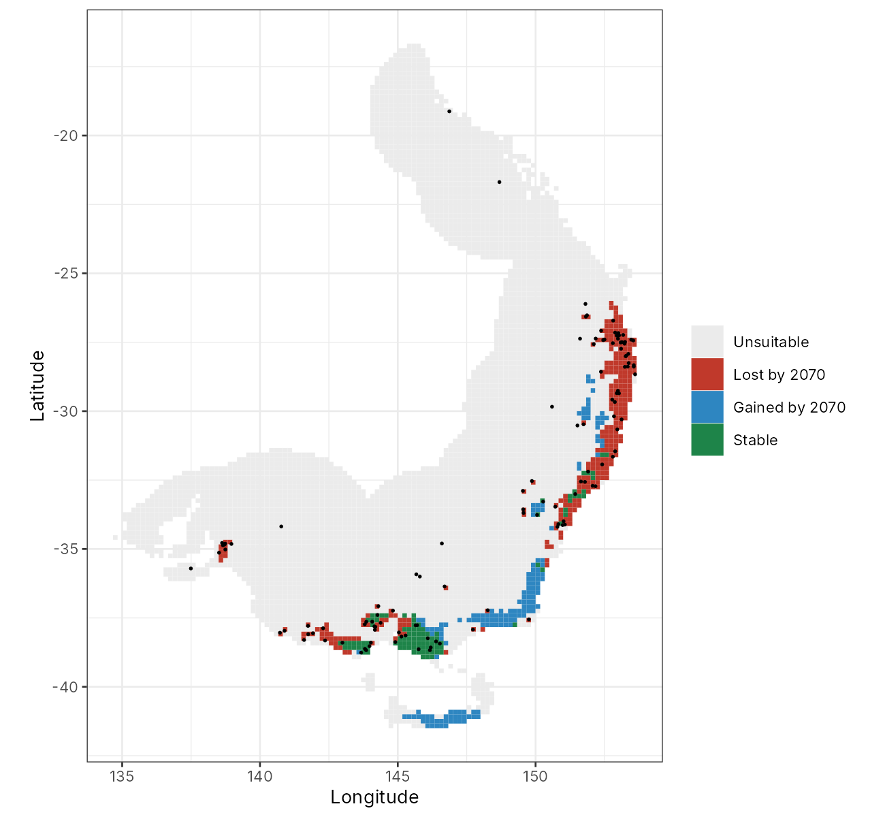

# Koala climate suitability under climate change

A species distribution model for the koala (*Phascolarctos cinereus*) in eastern Australia. It uses GBIF occurrence records and WorldClim bioclimatic variables, compares four model types under random and spatial block cross-validation, and projects an ensemble to 2050 and 2070.



## Why spatial validation matters here

Koala records are clustered along the east coast. With random cross-validation, test points sit next to training points, so the scores look better than they really are. Spatial block cross-validation holds out whole 2° blocks instead.

| Model | AUC, random CV | AUC, spatial block CV | TSS, spatial block CV |
|---|---|---|---|
| GLM (quadratic) | 0.851 | 0.790 | 0.545 |
| GAM | 0.852 | 0.787 | 0.550 |
| Boosted regression trees | 0.853 | 0.773 | 0.523 |
| Random forest | 0.817 | 0.759 | 0.522 |

Every model loses 0.06 to 0.08 AUC when tested on spatially separate blocks. Random forest had the most variable fold scores. The ensemble weights come from the spatial block scores, not the random ones.



## Projected change (ACCESS1-0, RCP8.5)

| Period | Suitable area (km²) | Change from current | Study area with novel climate |
|---|---|---|---|
| Current | 111,064 | | |
| 2050 | 95,120 | −14% | 28% |
| 2070 | 71,572 | −36% | 46% |

Suitable cells use the 10th percentile training presence threshold (0.62). Loss is greatest in south-east Queensland and northern New South Wales. Gains appear in East Gippsland and in Tasmania. Koalas do not occur in Tasmania, so the gain there is climatic only. Large parts of the study area move outside the climate range seen in training by 2070, so projections there are extrapolations.



## Method

1. **Occurrences.** 500 GBIF records. Records west of 136° E (captive or erroneous) were removed, then one record was kept per 10 arc-minute cell, which left 120 presences.
2. **Background.** Up to 10,000 points within 300 km of records (7,416 cells available). Presences and background were weighted to equal total weight.
3. **Predictors.** Candidates were screened in order of ecological priority, starting with heat and drought, and kept only if |Spearman r| < 0.7 with every variable already kept. Retained: bio5, bio12, bio17, bio15, bio6, bio4, bio9.
4. **Models.** GLM with quadratic terms, GAM (mgcv), random forest (ranger) and boosted regression trees (gbm).
5. **Validation.** Five-fold random CV and five-fold spatial block CV (2° blocks), scored with AUC and TSS.
6. **Ensemble and projection.** Weighted mean of models with spatial block AUC ≥ 0.7. Cells where any predictor lies outside the training range are reported as novel climate.

## Run it

```r
source("install_packages.R")
source("R/00_get_climate.R")   # only needed for the CMIP6 option
source("run_all.R")            # about 1 minute
```

Settings are in `config.R`. Set `CLIMATE_SOURCE <- "wc21_cmip6"` to download WorldClim 2.1 and a CMIP6 model with the `geodata` package instead of using the local WorldClim 1.4 and CMIP5 layers.

## Repository layout

```
config.R               settings
run_all.R              runs steps 01 to 03
R/functions.R          folds, models, metrics, novelty mask
R/01_prepare_data.R    occurrences, background, predictor selection
R/02_validate.R        random vs spatial block cross-validation
R/03_project.R         ensemble, future projection, area change
data/raw/              GBIF presence records
outputs/figures/       maps and plots
outputs/tables/        CV scores, ensemble weights, suitable area
```

## Limits

* Only 500 records were downloaded, and 120 remained after thinning. A full download through the Atlas of Living Australia (the `galah` package) would give much better coverage, especially for inland populations.
* Climate alone does not decide where koalas live. Food tree species, land clearing and fire are not in the model.
* The results use one climate model (ACCESS1-0) and one emissions scenario (RCP8.5).

## Data sources

* GBIF.org occurrence records for *Phascolarctos cinereus*, retrieved with `rgbif`.
* Hijmans et al. (2005) WorldClim 1.4. Very high resolution interpolated climate surfaces for global land areas. *International Journal of Climatology* 25, 1965–1978.

## Author

Hammed Akano, Deakin University. MIT licence.
